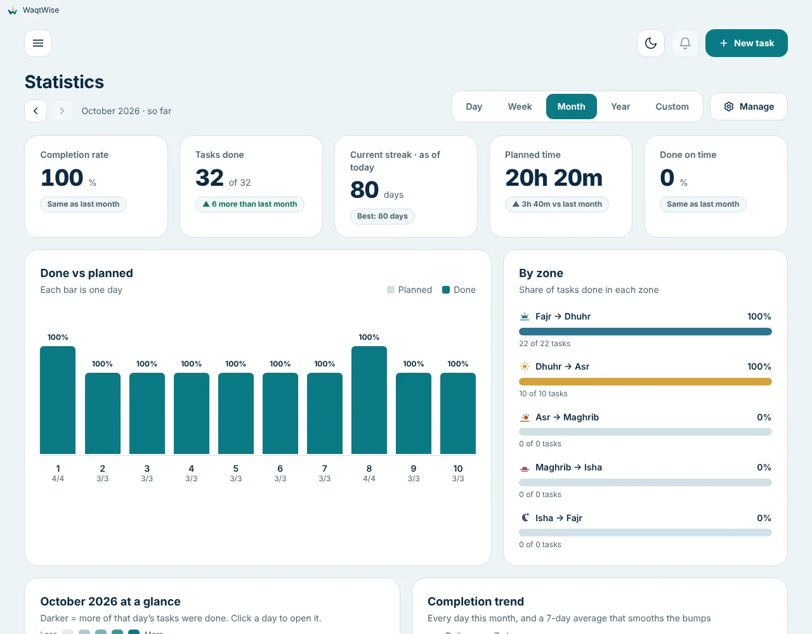

<p align="center">
  
</p>

<h1 align="center">WaqtWise</h1>
<p align="center"><b>Make every waqt count, wisely.</b><br>
A free day planner for Windows that divides your day into five zones by the prayer times.</p>

<p align="center">
  <a href="../../releases/latest"><b>⬇ Download for Windows</b></a> ·
  <a href="docs/USER_GUIDE.md">User guide</a> ·
  <a href="README.ar.md">العربية</a> ·
  <a href="docs/WINDOWS_WARNING.md">"Windows protected your PC"?</a>
</p>

<p align="center">
  
  
  
  
</p>

<p align="center">
  
</p>

## What it does

Your day is split into **five zones** - Fajr to Dhuhr, Dhuhr to Asr, Asr to Maghrib, Maghrib to Isha, Isha to Fajr.
Add a task and it lands in the right zone by itself, so you always see how much time you have before the next prayer.

- **Smart start times**: a fixed time, *10 minutes after Asr*, or *15 minutes after the end of another task*.
- **Repeats**: daily, weekly, monthly (first Friday, last working day, ...), yearly; change one, the following, or all.
- **Reminders and hard-to-miss full-screen alerts** with snooze, "open task" and "mark as done", and one random note each time.
- **Free To-Do list** for things with no time yet; schedule them when you decide.
- **Statistics**: completion, streaks, done on time, lateness, heat map, by zone and category.
- **Any country and city** (about 30,000 cities, 209 countries), 12 calculation methods, manual minute adjustments, Hijri date.
- **English and Arabic** (full right-to-left), light and dark themes.
- **Private by design**: works offline, no account, no tracking; everything stays on your computer.

| | |
| --- | --- |
|  |  |
|  |  |

## Install

1. Download **WaqtWise-Setup-&lt;version&gt;.exe** from the [latest release](../../releases/latest).
2. Run it. If Windows shows **"Windows protected your PC"**, click **More info → Run anyway**.
   This happens because the installer is not signed yet and the app is new; it does not mean the file is unsafe.
   Read [why, and how to check your download](docs/WINDOWS_WARNING.md).
3. Choose your country and city on the welcome screen and start planning.

Requires Windows 10 or 11 (64-bit). No administrator rights. The app never updates itself: to update, run the newer installer.

## Learn more

- [User guide](docs/USER_GUIDE.md) (every feature and setting, FAQ, troubleshooting) · [دليل المستخدم](docs/USER_GUIDE.ar.md)
- [Privacy](PRIVACY.md) · [Security policy](SECURITY.md) · [Code signing policy](docs/CODE_SIGNING_POLICY.md)
- [What changed in each version](docs/CHANGELOG.md)
- [Contributing](CONTRIBUTING.md) · [Code of conduct](CODE_OF_CONDUCT.md) · [Developer notes](docs/DEVELOPMENT.md)

## License

WaqtWise is free software under the **GNU General Public License v3.0 or later** ([LICENSE](LICENSE)): you may use,
study, share and change it, and if you share a changed version you must share its source under the same license.
The name, logo and icon are not covered by the license; see [NOTICE.md](NOTICE.md). Third-party components and data
(including city data from GeoNames, CC BY 4.0) are listed in [THIRD_PARTY_NOTICES.md](THIRD_PARTY_NOTICES.md).

## Build it yourself

```
npm ci
npm start      # run
npm test       # tests
npm run dist   # Windows installer (run on Windows)
```

More in [docs/DEVELOPMENT.md](docs/DEVELOPMENT.md).
