

# دليل مستخدم «وقت وايز» (WaqtWise)

**اللغات:** [English](USER_GUIDE.md) · العربية

يشرح هذا الدليل ما هو التطبيق، وكيف يعمل نظامه، وكل ما يمكنك فعله به. لا يحتاج أي معرفة تقنية.

**المحتويات**
1. [ما هو وقت وايز](#1-ما-هو-وقت-وايز)
2. [التثبيت](#2-التثبيت)
3. [أول تشغيل](#3-أول-تشغيل)
4. [الفكرة: خمس مناطق](#4-الفكرة-خمس-مناطق)
5. [العرض اليومي](#5-العرض-اليومي)
6. [المهام](#6-المهام)
7. [قائمة المهام الحرة](#7-قائمة-المهام-الحرة)
8. [التذكيرات والتنبيه بملء الشاشة](#8-التذكيرات-والتنبيه-بملء-الشاشة)
9. [الإحصائيات](#9-الإحصائيات)
10. [الإعدادات قسم بقسم](#10-الإعدادات-قسم-بقسم)
11. [بياناتك والنسخ الاحتياطية والخصوصية](#11-بياناتك-والنسخ-الاحتياطية-والخصوصية)
12. [العمل في الخلفية وأيقونة الإشعارات والتشغيل مع ويندوز](#12-العمل-في-الخلفية-وأيقونة-الإشعارات-والتشغيل-مع-ويندوز)
13. [التحديث وإلغاء التثبيت](#13-التحديث-وإلغاء-التثبيت)
14. [أسئلة شائعة وحل المشكلات](#14-أسئلة-شائعة-وحل-المشكلات)
15. [لوحة المفاتيح وسهولة الوصول](#15-لوحة-المفاتيح-وسهولة-الوصول)

---

## 1. ما هو وقت وايز

«وقت وايز» تطبيق مجاني لنظام ويندوز ينظّم يومك حول مواقيت الصلاة الخمس. بدل جدول ساعات عادي، يُقسَّم يومك إلى
**خمس مناطق** (من الفجر إلى الظهر، من الظهر إلى العصر، من العصر إلى المغرب، من المغرب إلى العشاء، من العشاء إلى الفجر).
تضيف مهامك فتذهب كل مهمة إلى منطقتها تلقائيًا، فترى دائمًا كم بقي لك من وقت قبل الصلاة التالية.

- يعمل **بدون إنترنت**؛ تُحسب مواقيت الصلاة على جهازك.
- كل شيء يبقى **على جهازك**: لا حساب ولا تسجيل دخول ولا تتبّع. راجع [الخصوصية](../PRIVACY.md).
- واجهة بالعربية (من اليمين لليسار بالكامل) والإنجليزية، ومظهر فاتح وداكن.
- مجاني ومفتوح المصدر بموجب رخصة GNU GPL الإصدار 3 أو أحدث. راجع [NOTICE](../NOTICE.md).

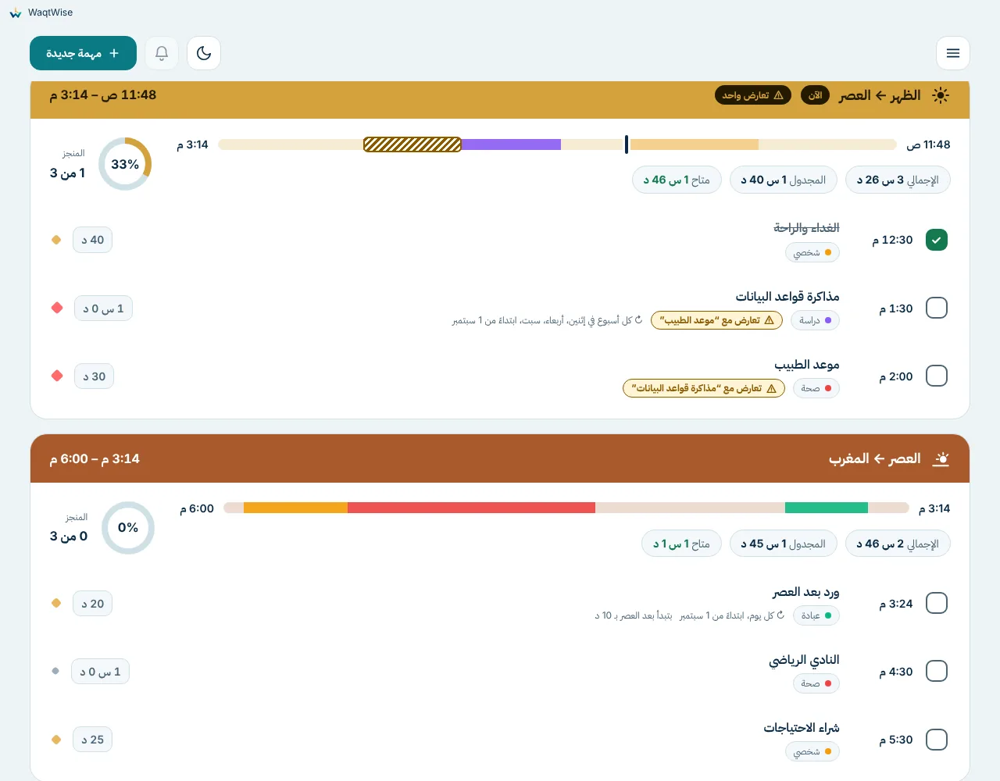

## 2. التثبيت

**المطلوب:** ويندوز 10 أو 11 (64 بت). لا يلزم صلاحيات المسؤول.

1. افتح [أحدث إصدار](../../../releases/latest) ونزّل الملف **WaqtWise-Setup-&lt;الإصدار&gt;.exe**.
2. انقر عليه مرتين. قد يظهر لك شاشة زرقاء مكتوب فيها **«Windows protected your PC»** (‏SmartScreen). هذا متوقع لتطبيق
   جديد ومجاني لم يُوقَّع بعد. اضغط **More info** ثم **Run anyway**. الشرح الكامل وطريقة التأكد من سلامة الملف في
   [WINDOWS_WARNING.ar.md](WINDOWS_WARNING.ar.md).
3. اضغط **Next**، اختر مكان التثبيت (المقترح مناسب)، ثم **Install**، ثم **Finish**.
4. يُنشأ اختصار على سطح المكتب وفي قائمة ابدأ.

## 3. أول تشغيل

تسألك شاشة الترحيب عن **البلد** ثم **المدينة**. اختر البلد، واكتب بضعة أحرف من اسم المدينة ثم اضغط عليها،
ثم **ابدأ التخطيط**. يمكنك تغييرهما لاحقًا من الإعدادات.

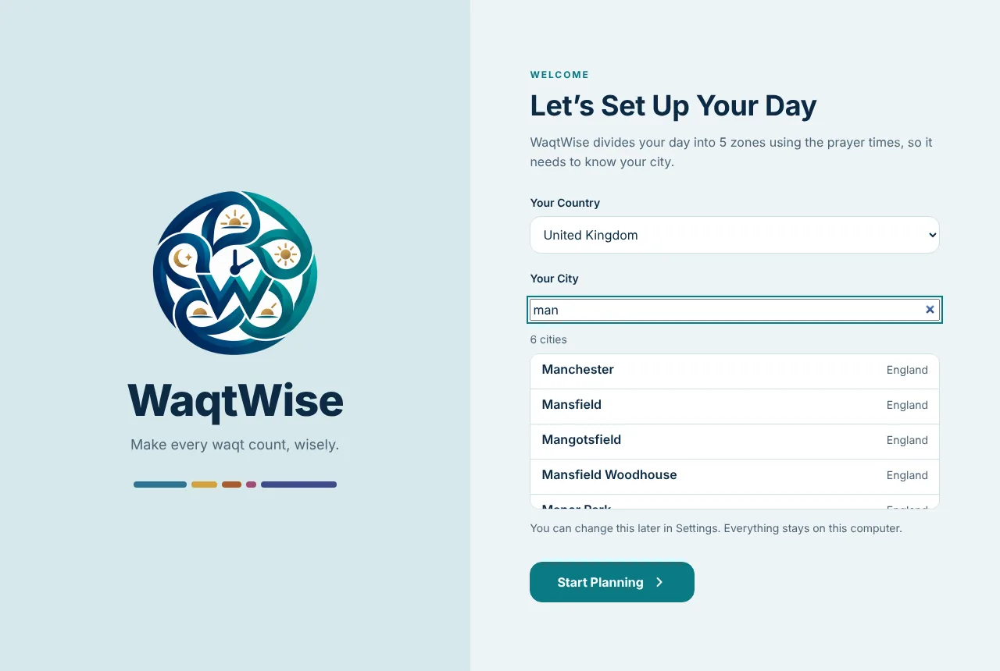

- تغطي القائمة نحو 30 ألف مدينة يبلغ عدد سكانها 15 ألفًا أو أكثر في 209 دول. وتُختار تلقائيًا طريقة الحساب الشائعة في بلدك.
- قارن مواقيت الصلاة أعلى كل منطقة بتقويم تثق به. إن اختلف وقت بدقائق قليلة فأضف أو اطرح دقائق لتلك الصلاة من
  الإعدادات ← مواقيت الصلاة. ويمكنك أيضًا اختيار طريقة حساب أخرى.
- مدينتك غير موجودة؟ استخدم **مدينة مخصصة…** وأدخل الاسم وخط العرض وخط الطول والمنطقة الزمنية.

## 4. الفكرة: خمس مناطق

| المنطقة | من | إلى |
| --- | --- | --- |
| 1 | الفجر | الظهر |
| 2 | الظهر | العصر |
| 3 | العصر | المغرب |
| 4 | المغرب | العشاء |
| 5 | العشاء | الفجر (صباح اليوم التالي) |

لكل منطقة لونها. تنتمي المهمة إلى المنطقة التي **تبدأ** فيها. «يوم التخطيط» يبدأ عند الفجر: فإن كانت الساعة
الواحدة صباحًا فأنت ما زلت في آخر منطقة من اليوم السابق، ويعرض التطبيق ذلك اليوم.

## 5. العرض اليومي

الشاشة الرئيسية تعرض يومًا واحدًا: المناطق من الأعلى إلى الأسفل وبداخلها المهام.

- **الشريط العلوي:** التاريخ (مع الهجري)، وأسهم وشريط أسبوع للتنقل بين الأيام، وزر **اليوم**، ودائرة إنجاز اليوم،
  وجرس التذكيرات الفائتة، وزر المظهر فاتح/داكن، وزر **مهمة جديدة**.
- **كل منطقة:** وقت بدايتها ونهايتها، وشريط زمني يبيّن المهام والفراغ، والوقت المخطط، والوقت الحر المتبقي، ودائرة إنجازها.
- **كل مهمة:** دائرة للتأشير (اضغط لتحديدها منجزة)، والعنوان، وتفاصيل صغيرة (الوقت، المدة، الأولوية، التصنيف، التكرار…).
  **اضغط على المهمة** لعرض تفاصيلها، ويفتح **تعديل المهمة** نموذج التعديل.
- **التعارض:** إذا تداخلت مهمتان تظهر على كل منهما علامة *تعارض*. لا يُمنع شيء؛ القرار لك.
- **عرض أقصر:** المنطقة الخالية، أو المنتهية في الماضي، تتقلص إلى سطر واحد. اضغط عليها لفتحها، واستخدم السهم في شريطها لإخفائها.
  المنطقة المنتهية وفيها مهمة غير منجزة تبقى مفتوحة وتكتب «N غير منجزة». عند فتح اليوم الحالي يمرّر العرض إلى المنطقة الجارية.
  يمكنك إيقاف ذلك من الإعدادات ← العرض اليومي.
- **التفاصيل التي تريدها:** الإعدادات ← العرض اليومي تحدد ما يظهر في كل صف.

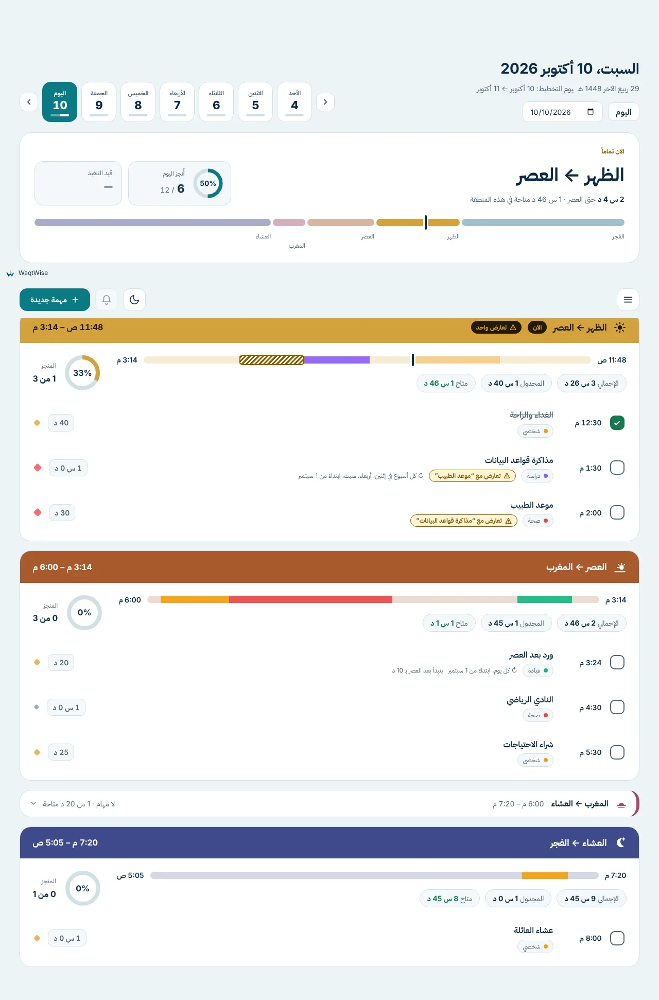

## 6. المهام

اضغط **مهمة جديدة** واملأ:

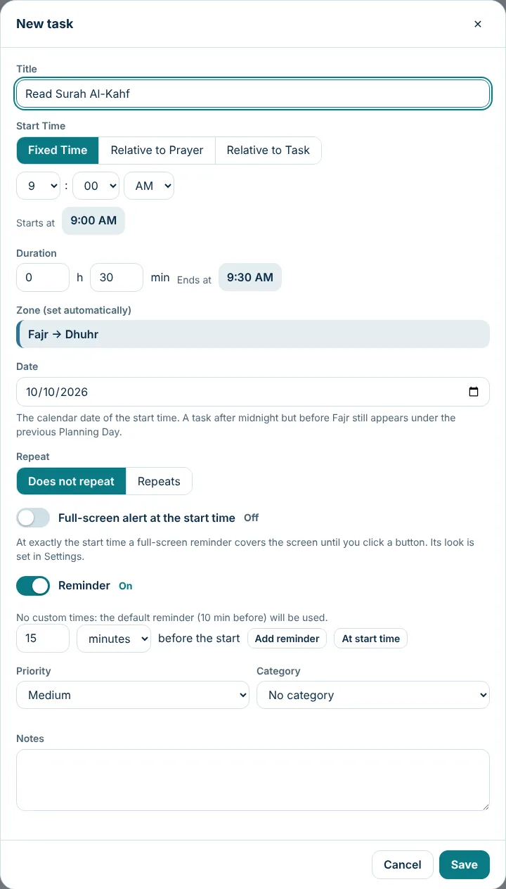

- **العنوان** (حتى 200 حرف) و**ملاحظات** اختيارية.
- **وقت البدء** (بثلاث طرق):
  - **وقت ثابت** (Fixed Time): مثل 9:00 صباحًا.
  - **بالنسبة للصلاة**: مثل «10 دقائق بعد العصر».
  - **بالنسبة لمهمة**: مثل «15 دقيقة بعد نهاية *مهمة أخرى*». إن لم تكن تلك المهمة في اليوم يُستخدم **وقت بدء احتياطي** تختاره ويظهر تحذير.

  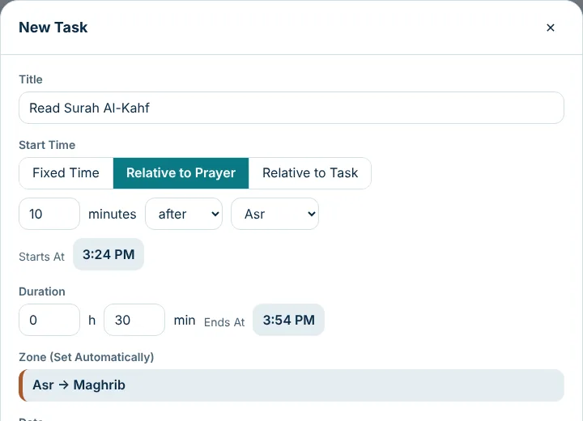
  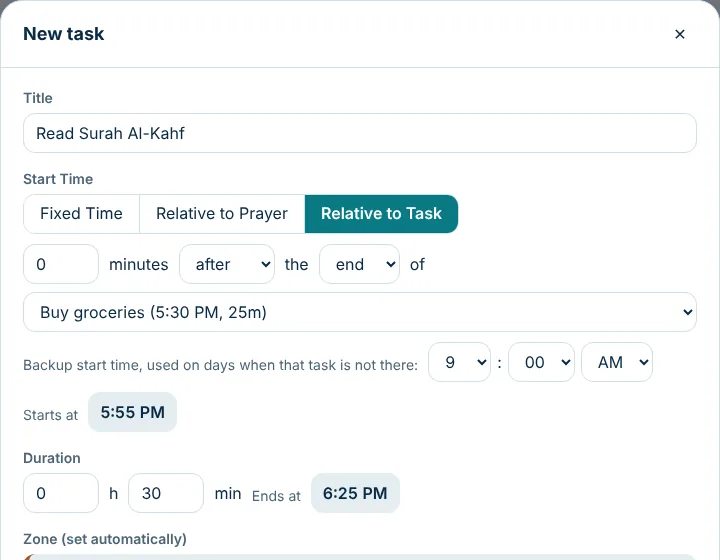
- **المدة** بالساعات والدقائق؛ ويعرض النموذج وقت الانتهاء والمنطقة.
- **التاريخ** و**التكرار**: بلا تكرار، يوميًا، أسبوعيًا (اختر الأيام، كل N أسابيع)، شهريًا (يوم من الشهر، آخر يوم،
  الأسبوع/اليوم رقم N مثل «أول جمعة»، آخر يوم عمل، أو أيام محددة)، أو سنويًا. وينتهي التكرار **أبدًا** أو في **تاريخ** أو بعد **N مرة**.

  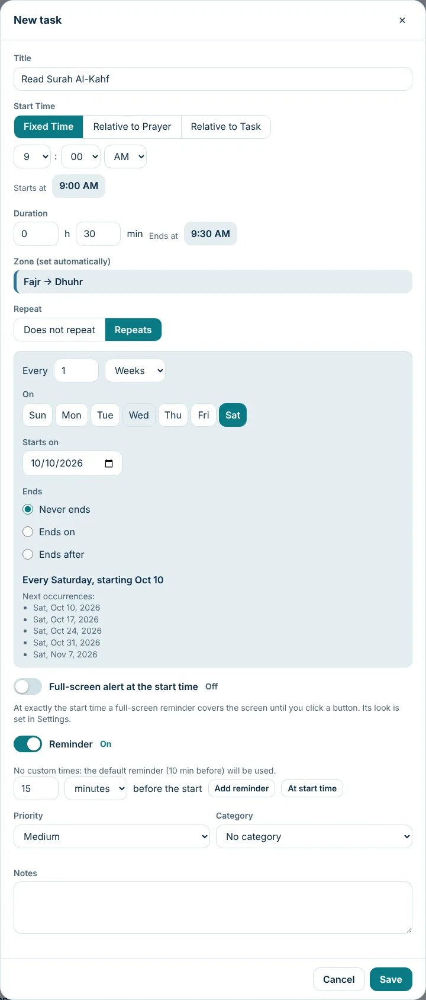
- **التصنيف** (الافتراضي: العمل، الدراسة، العبادة، شخصي، الصحة، ويمكنك إضافة غيرها) و**الأولوية** (عالية، متوسطة، منخفضة).
- **التذكيرات** و**تذكير ملء الشاشة** (انظر [القسم 8](#8-التذكيرات-والتنبيه-بملء-الشاشة)).

**تعديل مهمة متكررة.** يسألك التطبيق: هل يسري التغيير على هذه المرة فقط، أم عليها وعلى ما بعدها، أم على الكل؟ وكذلك الحذف.
ويمكنك تخطي تاريخ واحد دون المساس بالباقي.

**التأشير بالإنجاز.** اضغط الدائرة في صف المهمة. يتذكر التطبيق وقت التأشير ويستخدمه في إحصائيات «في الموعد». المهام المنجزة لا تُرسل لها تذكيرات.

**مهام تتبع مهامًا أخرى.** إذا حذفت مهمة تتبعها مهام أخرى يحذّرك التطبيق، وتحتفظ التابعة بأوقاتها الحالية كأوقات ثابتة.
التأشير بإنجاز مهمة لا يحرّك المهام التي بعدها.

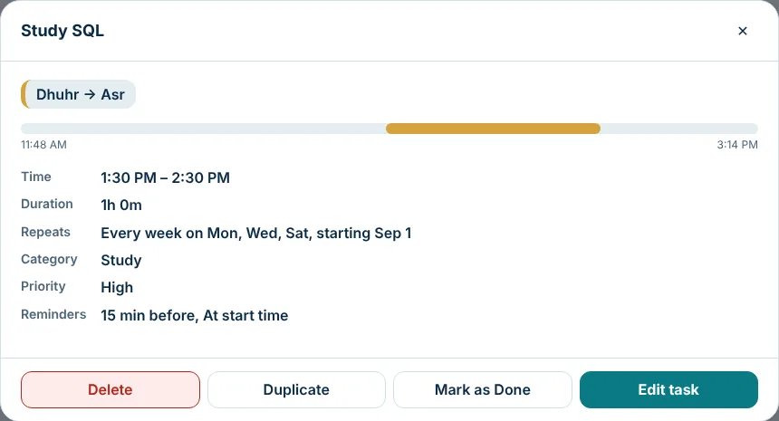

## 7. قائمة المهام الحرة

لما تريد تذكّره ولا تعرف وقته بعد. افتح القائمة واختر **قائمة المهام الحرة**.

- اكتب عنوانًا واضغط **Enter** للإضافة؛ و**إضافة بتفاصيل** يفتح النموذج الكامل.
- **جدولة المهمة** يفتح النموذج المعتاد وقد امتلأ العنوان والملاحظات؛ اختر الوقت واحفظ فتنتقل المهمة إلى المناطق الخمس.
- أشّر على المهمة لإنهائها، واستخدم الأسهم لإعادة الترتيب، وحدّد التصنيف والأولوية.

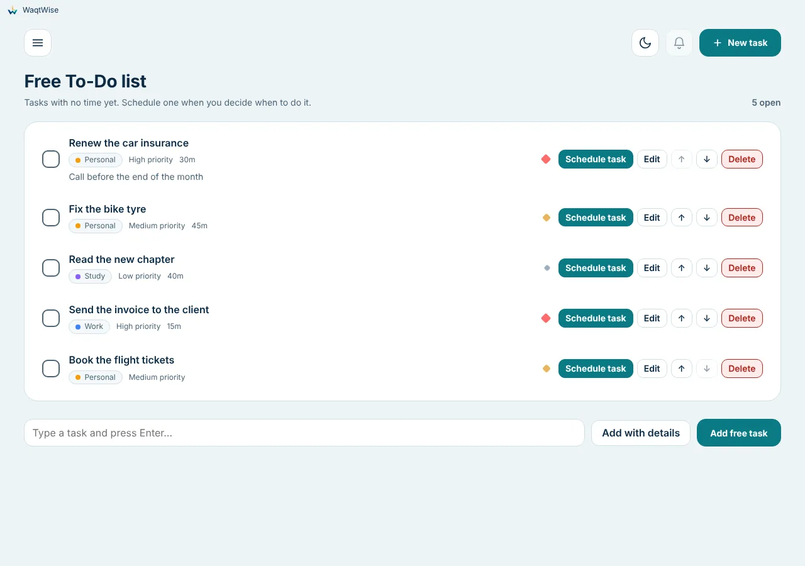

### الروتينات

للأشياء التي **تتكرر عدة مرات في اليوم**، مثل شرب الماء أو التمدد أو استراحة قصيرة. افتح القائمة واختر **الروتينات** ثم **إضافة روتين**.

- حدّد الفترة بـ **من** و**إلى** (مثلًا من 8:00 ص إلى 8:00 م؛ ويجوز أن تمتد الفترة بعد منتصف الليل).
- حدّد **التكرار كل** بخانتين منفصلتين للساعات والدقائق (5 دقائق على الأقل). أول مرة عند وقت البداية، ثم تتبعها المرات التالية بنفس المسافة ما دامت داخل الفترة. وسطر تحت الخانتين يعرض الأوقات التي سيرنّ فيها التذكير.
- حدّد **في هذه الأيام**: أي أيام من الأسبوع تريد.
- اختر طريقة التذكير: **إشعار** أو **تنبيه بملء الشاشة** أو **الاثنان معًا**. وتظل مفاتيح الإعدادات ← التذكيرات سارية. ويعمل التأجيل و«تم» على التنبيه بملء الشاشة كالمعتاد.
- **يأتي الإشعار قبل الموعد بـ**: عدد من الدقائق (0 = في الموعد بالضبط، حتى 120). الإشعار وحده هو الذي يأتي مبكرًا؛ أما التنبيه بملء الشاشة فيأتي دائمًا في الموعد بالضبط.
- **الصمت أثناء عمل هذه المهام**: اختر مهمة أو أكثر من مهامك. الموعد الذي يقع أثناء عمل إحداها (من بدايتها حتى نهايتها) لا يرنّ. والمهمة التي عُلّمت منجزة لا تُحتسب على أنها تعمل.
- **الهدوء وقت الصلاة**: إن وقع الموعد بين الأذان وعدد الدقائق التي تختارها بعده، فإنه يرنّ عند انتهاء فترة الهدوء بدلًا من ذلك (والموعد الذي يقع خارج الصلاة يرنّ في موعده).
- فعّل **عرض ملاحظة واحدة عشوائياً** ليعرض التنبيه بملء الشاشة ملاحظة مختلفة في كل مرة: اكتب عدة ملاحظات تفصل بينها `؛` ولا تتكرر ملاحظة حتى تُعرض كلها. (الإشعار لا يعرض الملاحظات أبداً.)
- تعرض بطاقة كل روتين اليوم بنظرة واحدة: عدد المواعيد المنجزة والصامتة والفائتة والقادمة، وشريط تقدّم، وخطًا زمنيًا لليوم. على الخط الزمني: النقطة الممتلئة موعد أشّرت عليه، والحلقة البرتقالية موعد مضى، والحلقة الرمادية موعد قادم، والنقطة المنقّطة موعد بقي صامتًا لأن إحدى المهام التي اخترتها كانت تعمل؛ وتُرسم هذه المهام كأشرطة تحت الخط. اضغط **صامت أثناء N مهام** لعرضها، و**عرض كل المواعيد** لرؤية كل موعد كزر. أشّر على الموعد (نقطة أو زرًّا) بعد أن تنجزه؛ والموعد الذي لم يحن بعد لا يمكن التأشير عليه. و**إيقاف مؤقت** يوقف الروتين دون حذفه. والوقت الذي يمرّ والجهاز مغلق أو في السكون يُتخطى ببساطة.

والروتينات منفصلة عن مهامك: لا تظهر في المناطق الخمس، لكن في **الإحصائيات** بطاقة **الروتينات** (تحسب المواعيد التي مضت فقط، في الأيام التي ينطبق عليها الروتين، منذ إنشائه؛ وأضِفها من **إدارة** إن كنت قد حدّثت من إصدار أقدم). وتُحفظ مع بياناتك وتنتقل مع التصدير والاستيراد والنسخ الاحتياطية.

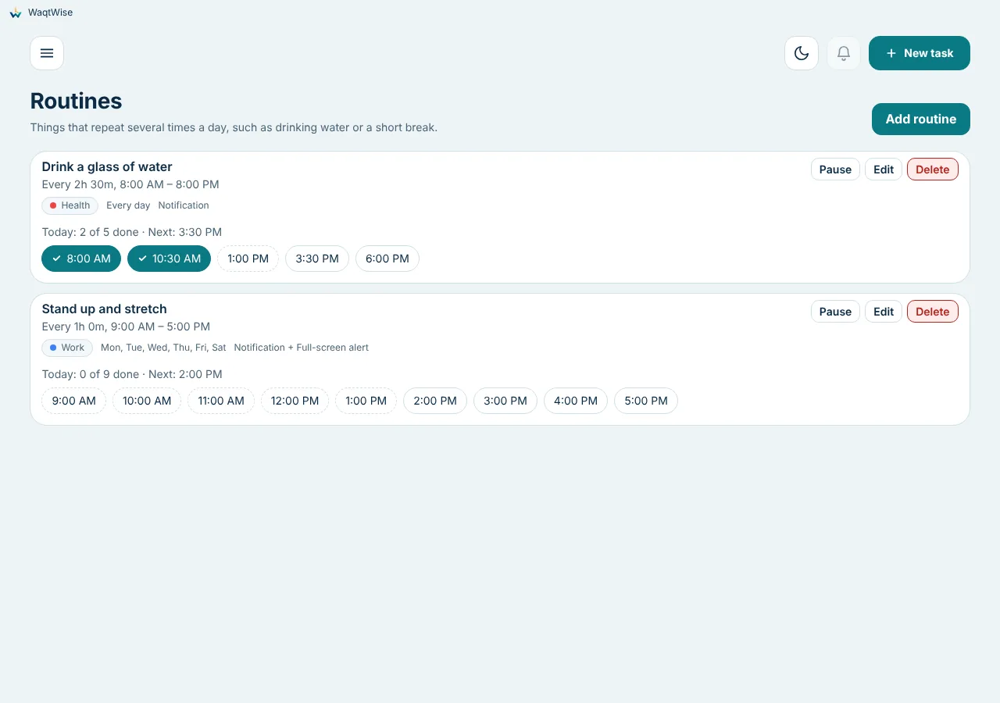

## 8. التذكيرات والتنبيه بملء الشاشة

**التذكيرات (إشعارات).** المهام الجديدة تأتي والتذكير مفعّل. وبدون أوقات مضافة يذكّرك **قبل 10 دقائق** (قابلة للتغيير).
يمكنك إضافة عدة تذكيرات لمهمة واحدة، مثل قبل ساعة وعند البدء. اضغط على الإشعار لفتح التطبيق على العرض اليومي.

**التذكيرات الفائتة.** إن كان الجهاز مغلقًا أو في السكون يعرض الجرس ما فاتك. والتذكير المتأخر حتى دقيقتين يظهر عاديًا.

**التنبيه بملء الشاشة.** للمهام التي لا يجوز أن تفوتك فعّل **التنبيه بملء الشاشة عند وقت البدء**. في الثانية المحددة تعرض الشاشة
كلها (وكل الشاشات إن وُجدت أكثر من واحدة) المهمة حتى تضغط زرًا:

- **تمام** (موجود دائمًا)، **تأجيل**، **فتح المهمة**، **تحديد كمنجزة**.
- **ملاحظة عشوائية واحدة:** اكتب عدة ملاحظات تفصل بينها `;` (مثل `اشرب ماء; تمدّد; تنفّس`) وفعّل *عرض ملاحظة واحدة عشوائياً*.
  يعرض كل تنبيه ملاحظة واحدة، وتُستخدم كلها قبل أن تتكرر أي ملاحظة.
- تُتجاهل عمدًا الضغطات الأولى بعد ظهوره حتى لا يُغلق بالخطأ أثناء الكتابة.
- إن تأخر أكثر من 15 ثانية (مثلًا بعد السكون) تنتقل المهمة إلى قائمة الفائت.
- الشكل والألوان والخط والحجم والأزرار: الإعدادات ← تذكير ملء الشاشة (مع أشكال جاهزة وزر معاينة ملء الشاشة).

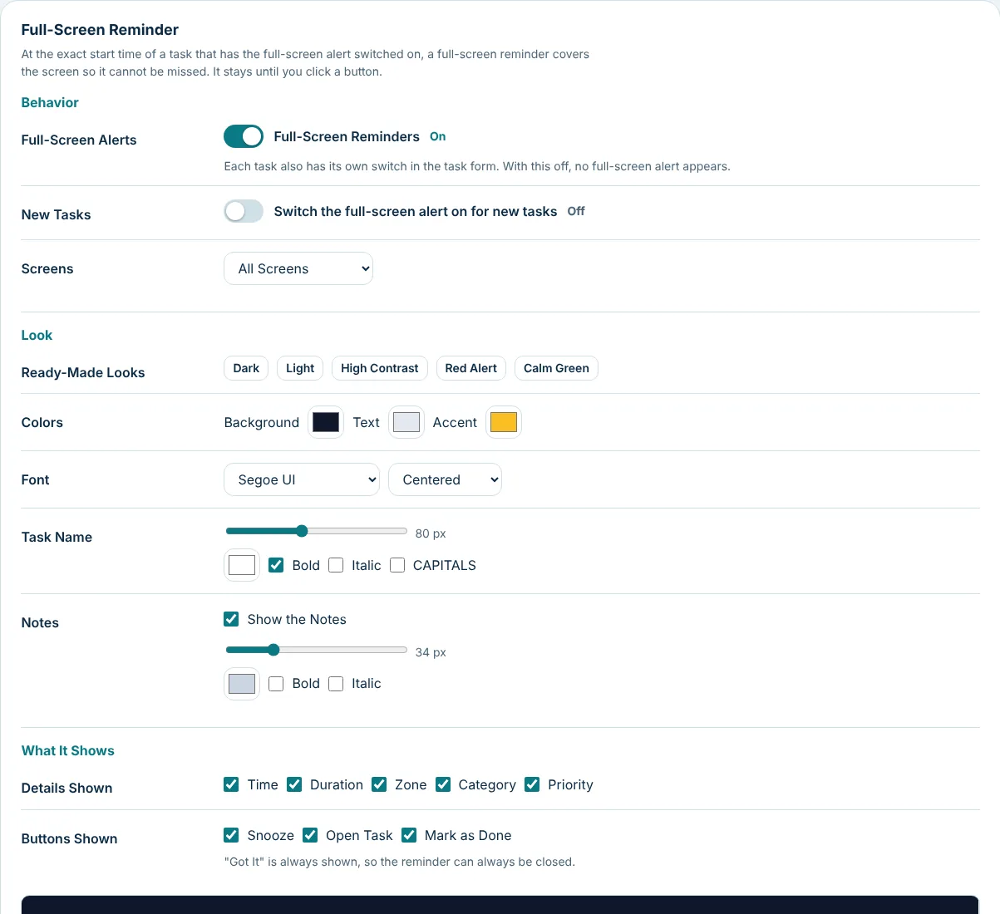

بعض الألعاب والفيديوهات تعمل بوضع الشاشة الكاملة الحصري وقد تخفي كل النوافذ الأخرى. استعمل وضع النافذة أو «ملء الشاشة بلا حدود» إن لم يظهر التنبيه.

## 9. الإحصائيات

افتح **الإحصائيات** من القائمة. اختر **يوم، أسبوع، شهر، سنة** أو **مخصص**، وتنقّل بالأسهم.

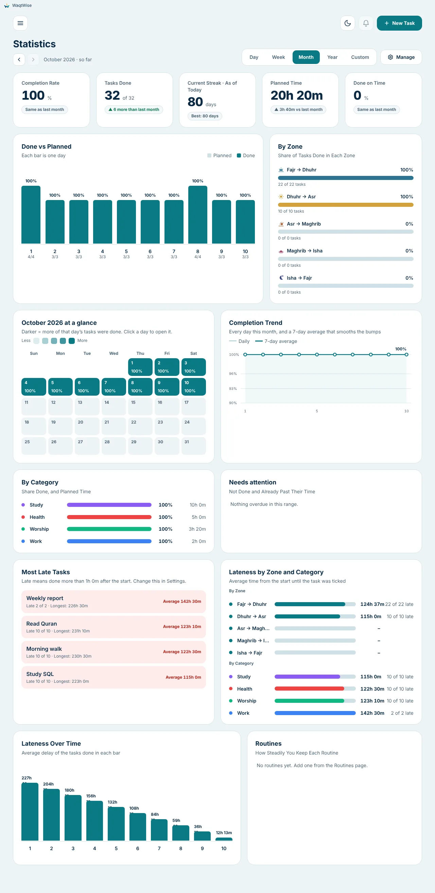

المخططات (زر **إدارة** يتيح إظهارها وإخفاءها وترتيبها):

| المخطط | ماذا يعرض |
| --- | --- |
| نسبة الإنجاز | نسبة المهام المحسوبة المنجزة |
| المهام المنجزة | كم أُنجز من كم |
| السلسلة الحالية | أيام متتالية أُنجز فيها 70% على الأقل |
| الوقت المخطط | مجموع وقت المهام المحسوبة |
| اتنفذت في الميعاد | نسبة المنجزة غير المتأخرة |
| المنجز مقابل المخطط | عمود لكل يوم |
| حسب المنطقة | نسبة الإنجاز في كل منطقة من الخمس |
| خريطة التقويم الحرارية | كل يوم بلون؛ اضغط يومًا لفتحه |
| اتجاه الإنجاز | حركة النسبة مع خط مُمهَّد |
| حسب التصنيف | نسبة الإنجاز والوقت لكل تصنيف |
| تحتاج انتباهاً | مهام لم تُنجز وتجاوزت وقتها |
| أكتر المهام تأخيرًا | أي المهام تُنجز متأخرة وبمتوسط كم |
| التأخير حسب الفترة والتصنيف | متوسط التأخير في كل منهما |
| التأخير عبر الوقت | متوسط التأخير لكل يوم أو أسبوع أو شهر |
| الروتينات | لكل روتين: نسبة مواعيده المنجزة، وسلسلة الأيام الحالية، وآخر الأيام في مربعات صغيرة، والموعد الذي تفوّته أكثر |

تُحفظ إحصائيات الأيام المنتهية، فتعديل مهمة أو حذفها لاحقًا لا يغيّر الماضي. وتُعدّ المهمة **متأخرة** إن أشّرت عليها بعد
مدة معينة من بدئها (الإعدادات ← التطبيق ← المهام المتأخرة). المهام المؤشَّر عليها في إصدارات قديمة جدًا ليس لها وقت تأشير ولا تُحسب في التأخر.

## 10. الإعدادات قسم بقسم

القائمة ← **الإعدادات**. صف أزرار في الأعلى ينقلك إلى كل قسم.

| القسم | ما يمكنك تغييره |
| --- | --- |
| **اللغة** | العربية أو English فورًا. نصوصك (عناوين المهام والملاحظات وتصنيفاتك) لا تُترجم. الأرقام دائمًا 0123456789. |
| **مواقيت الصلاة** | البلد والمدينة (أو مدينة مخصصة)، وطريقة الحساب (12 طريقة)، ودقائق الزيادة أو النقص لكل صلاة، وتعديل التاريخ الهجري. |
| **التذكيرات والإشعارات** | إشعارات ويندوز، الصوت، وقت التذكير الافتراضي (قبل 10 دقائق)، مدة الغفوة، إشعار عند بدء كل منطقة، وزر **إرسال إشعار تجريبي**. |
| **التطبيق** | **البدء مع ويندوز**، رسالة الخلفية، المظهر (النظام/فاتح/داكن)، أول يوم في الأسبوع، **المهام المتأخرة**، وأيام العمل (تُستخدم في «آخر يوم عمل»). |
| **العرض اليومي** | ما تعرضه كل مهمة (مع إعدادات جاهزة: *إظهار الكل* و*قياسي* و*الاسم فقط* ومعاينة مباشرة)، وطيّ المناطق الخالية والمنتهية. |
| **تذكير ملء الشاشة** | هل يُفعَّل للمهام الجديدة، أي الشاشات، الألوان والخط وأحجام الاسم والملاحظات، التفاصيل والأزرار، وأشكال جاهزة. |
| **الأصوات** | صوت إنجاز المهمة وصوت التنبيه بملء الشاشة (أو إيقافهما). |
| **التصنيفات** | إضافة وتسمية وتلوين وحذف التصنيفات. حذف تصنيف يزيله من المهام. |
| **البيانات** | تصدير واستيراد واستعادة من نسخة احتياطية. |

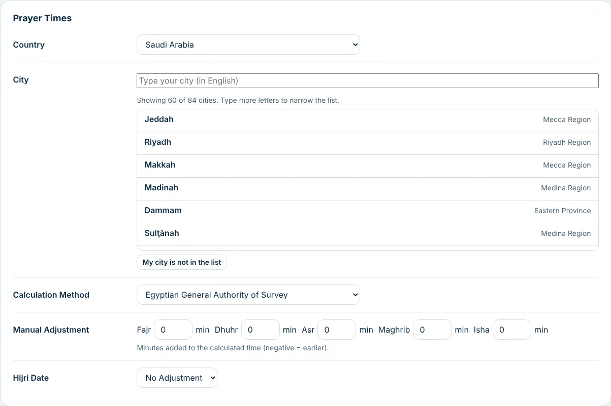
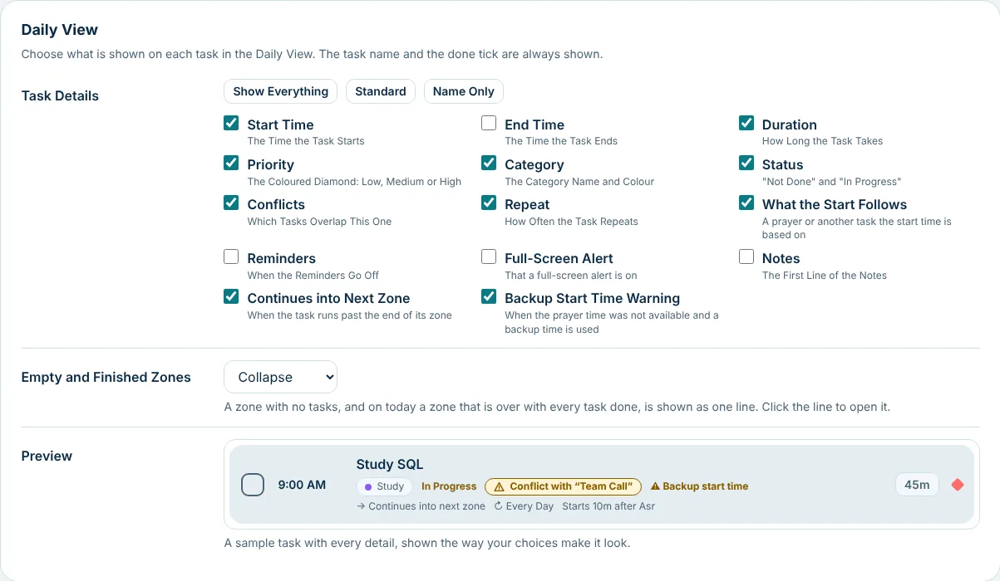

**مدينة غير موجودة في القائمة.** الإعدادات ← مواقيت الصلاة ← المدينة ← **مدينة مخصصة…**: اكتب الاسم وخط العرض وخط الطول
والمنطقة الزمنية (مثل `Asia/Riyadh`؛ وزر يملأ المنطقة الزمنية لهذا الجهاز) ثم زر حفظ المدينة. تُعرض بداية كل منطقة ونهايتها بتوقيت تلك المدينة،
وتبقى مهامك على ساعة جهازك. الأماكن القريبة جدًا من القطبين حيث لا تشرق الشمس أو لا تغرب لا يمكن استخدامها، ويخبرك التطبيق بذلك.

**المهام المتكررة كل أسبوعين أو أكثر** تحسب أسابيعها من أول يوم في الأسبوع المختار في الإعدادات؛ وتغييره قد ينقلها إلى أسابيع أخرى.

## 11. بياناتك والنسخ الاحتياطية والخصوصية

- كل شيء مخزّن **على جهازك فقط** في مجلد بيانات التطبيق (`%APPDATA%\WaqtWise`، الملفان `data.json` و`state.json`).
  لا يستخدم «وقت وايز» الشبكة إطلاقًا.
- **تصدير البيانات…** (من القائمة أو الإعدادات ← البيانات) يحفظ ملف نسخة احتياطية. و**استيراد البيانات…** يستعيد واحدة، ويستبدل ما في التطبيق،
  فصدّر أولًا إن لم تكن متأكدًا. تحمل النسخة أيضًا الإحصائيات المحفوظة فتنتقل معك إلى جهاز آخر.
- **نسخ تلقائية:** نسخة كل يوم (آخر 7 أيام) ونسخة قبل كل استيراد أو استعادة (آخر 5 من كل نوع) في مجلد `backups`.
  للرجوع: الإعدادات ← البيانات ← **استعادة من نسخة احتياطية…** اختر نسخة ثم زر الاستعادة. وتُحفظ بياناتك قبل الاستعادة فيمكن التراجع عنها.
- إن فشل الحفظ (قرص ممتلئ، ملف مقفل) يبقى شريط أحمر في الأعلى فيه **Try Again** (حاول مرة أخرى) و**Export a Copy**.

للمزيد: [الخصوصية](../PRIVACY.md) و[صيغة البيانات](DATA_FORMAT.md) (بالإنجليزية).

## 12. العمل في الخلفية وأيقونة الإشعارات والتشغيل مع ويندوز

- إغلاق النافذة أو تصغيرها **يُبقي التطبيق يعمل في منطقة الإشعارات** (الأيقونات الصغيرة قرب الساعة؛ قد تحتاج السهم الصغير).
  بهذا تظهر التذكيرات والنافذة مغلقة. ويخبرك التطبيق بذلك أول مرة.
- اضغط أيقونة التطبيق لفتح النافذة. وبزر الفأرة الأيمن: **Open / Show** و**Hide / Minimize** و**Exit** (بالإنجليزية في قائمة الأيقونة). **Exit** يوقف التطبيق وتتوقف التذكيرات. وفي أعلى القائمة سطر معلومات بـ**المهمة التالية** التي لم تبدأ بعد، وبندان منفصلان: **إيقاف التذكيرات مؤقتًا** يُسكت إشعارات وتنبيهات المهام الموجودة في المناطق، و**إيقاف الروتينات مؤقتًا** يُسكت الروتينات؛ ولكلٍّ منهما **30 دقيقة أو ساعة أو ساعتان أو حتى الفجر القادم**. وما يقع أثناء الإيقاف يُتخطّى (لا يعود لاحقًا ولا يُضاف إلى التذكيرات الفائتة). يظهر موعد انتهاء الإيقاف في تلميح الأيقونة وفي القائمة، و**استئناف التذكيرات** أو **استئناف الروتينات** ينهيه مبكرًا. الإيقاف لا يُحفظ: إغلاق التطبيق ينهيه.
- الإعدادات ← التطبيق ← **البدء مع ويندوز** يشغّله عند تسجيل الدخول بهدوء في منطقة الإشعارات.
- النافذة تُفتح دائمًا مكبّرة. وتغيّر المنطقة الزمنية للجهاز يُلاحَظ خلال دقيقة تقريبًا.

## 13. التحديث وإلغاء التثبيت

- **التحديث:** لا يحدّث «وقت وايز» نفسه (لأنه لا يتصل بالإنترنت). نزّل المثبّت الأحدث من
  [صفحة الإصدارات](../../../releases) وشغّله. تبقى مهامك وإعداداتك.
- **إلغاء التثبيت:** إعدادات ويندوز ← التطبيقات ← WaqtWise ← إلغاء التثبيت. يسألك هل تحذف بياناتك أيضًا؛ اختر **No** لإبقائها.

## 14. أسئلة شائعة وحل المشكلات

**هل هو مجاني فعلًا؟ هل يوجد حساب أو إعلانات؟** مجاني ومفتوح المصدر، بلا حساب ولا إعلانات ولا تتبّع.

**لماذا يحذّرني ويندوز عند التثبيت؟** لأن المثبّت غير موقَّع بعد. راجع [WINDOWS_WARNING.ar.md](WINDOWS_WARNING.ar.md).

| المشكلة | ما تجرّبه |
| --- | --- |
| لا تظهر إشعارات | الإعدادات ← التذكيرات والإشعارات ← **إرسال إشعار تجريبي**. إن لم يظهر شيء: إعدادات ويندوز ← النظام ← الإشعارات، تأكد من تفعيلها وأن WaqtWise مسموح له، وأوقف «Focus assist / عدم الإزعاج». |
| الضغط على الإشعار لا يفتح التطبيق | من فضلك [بلّغ عنها](../../../issues/new/choose). |
| لعبة أو فيديو يخفي التنبيه | البرنامج بوضع الشاشة الكاملة الحصري. استخدم وضع النافذة أو بلا حدود. |
| اختفت النافذة | هي في منطقة الإشعارات. اضغط أيقونتها. |
| بعد تشغيل ويندوز تومض النافذة في شريط المهام فقط | اضغط عليها. وإن تكرر فبلّغ عنها. |
| مواقيت الصلاة تبدو خاطئة | تحقق من المدينة وطريقة الحساب، ثم عدّل دقائق الصلاة المختلفة. |
| مهمة تعرض «وقت بدء احتياطي» | هي تتبع مهمة غير موجودة في ذلك اليوم. غيّر المهمة التي تتبعها أو اقبل الوقت الاحتياطي. |
| لا أجد بلدتي الصغيرة | اختر بلدة أكبر قريبة، أو **مدينة مخصصة** بإحداثيات دقيقة. |
| أسماء المدن بالإنجليزية فقط | نعم، قائمة المدن بالإنجليزية حاليًا. أسماء الدول تتبع لغة التطبيق. |
| ضاع كل شيء بعد إعادة تثبيت ويندوز | استورد ملف النسخة الاحتياطية (القائمة ← استيراد البيانات…). صدّر بانتظام. |

## 15. لوحة المفاتيح وسهولة الوصول

- مفتاح Tab يبقى داخل النوافذ المنبثقة؛ وEnter وSpace يعملان على كل عنصر في القوائم؛ وEnter على زر التأشير يؤشّر فقط.
- يبقى التركيز على المهمة نفسها عند إعادة رسم اليوم.
- لا يقل حجم أي نص عن 12 بكسل، والتباين وفق الإرشادات الشائعة، والتطبيق ينعكس بالكامل للعربية.
- يتبع إعداد حجم النص في ويندوز (جُرّب 125% و150%).

---

*وجدت خطأ أو نقصًا في الدليل؟ [افتح بلاغًا](../../../issues/new/choose).*

