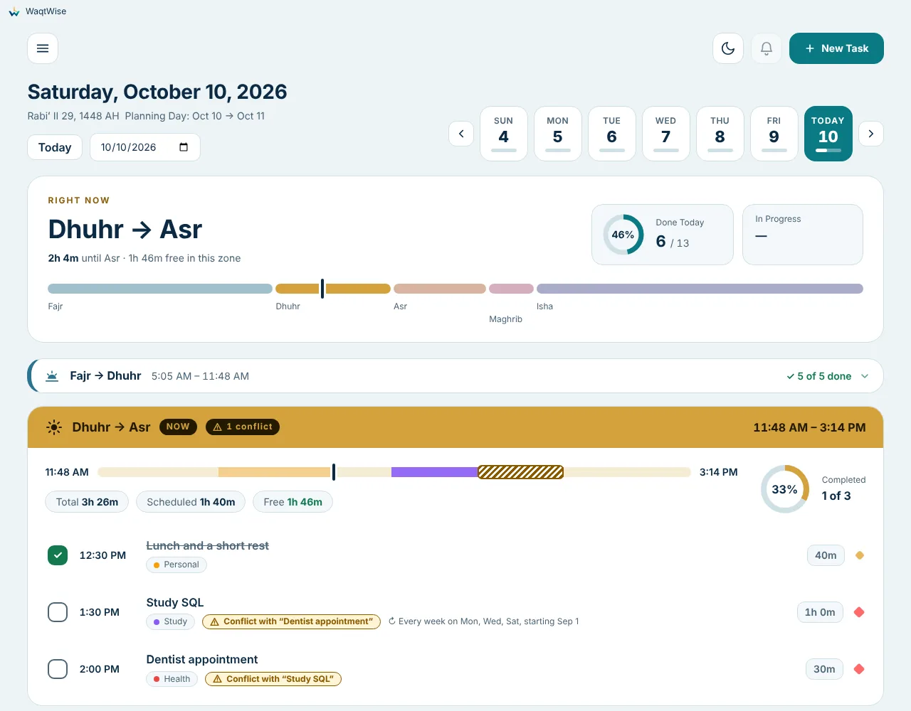
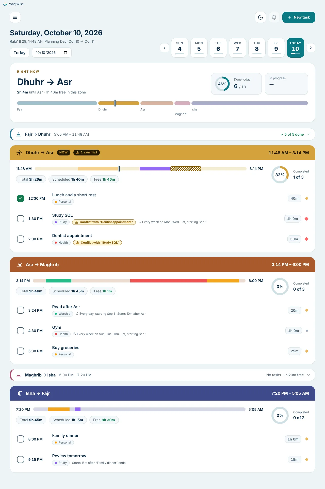

# WaqtWise user guide

**Languages:** English · [العربية](USER_GUIDE.ar.md)

This guide explains what WaqtWise is, how its system works, and every feature you can use. Nothing here needs
technical knowledge. Questions that are not answered here: see [FAQ and troubleshooting](#14-faq-and-troubleshooting).

**Contents**
1. [What WaqtWise is](#1-what-waqtwise-is)
2. [Install](#2-install)
3. [First start](#3-first-start)
4. [The idea: five zones](#4-the-idea-five-zones)
5. [The Daily View](#5-the-daily-view)
6. [Tasks](#6-tasks)
7. [Free To-Do list](#7-free-to-do-list)
8. [Reminders and full-screen alerts](#8-reminders-and-full-screen-alerts)
9. [Statistics](#9-statistics)
10. [Settings, section by section](#10-settings-section-by-section)
11. [Your data, backups and privacy](#11-your-data-backups-and-privacy)
12. [Background running, tray and Windows start](#12-background-running-tray-and-windows-start)
13. [Updating and uninstalling](#13-updating-and-uninstalling)
14. [FAQ and troubleshooting](#14-faq-and-troubleshooting)
15. [Keyboard and accessibility](#15-keyboard-and-accessibility)

---

## 1. What WaqtWise is

WaqtWise is a free Windows app that plans your day around the five daily prayer times. Instead of a plain hour
grid, your day is split into **five zones** (Fajr to Dhuhr, Dhuhr to Asr, Asr to Maghrib, Maghrib to Isha, Isha to
Fajr). You add tasks, and each task lands in the right zone by itself, so you always see how much room you have
before the next prayer.

- Works **without internet**. Prayer times are calculated on your computer.
- Everything stays **on your computer**. No account, no sign-in, no tracking. See [PRIVACY](../PRIVACY.md).
- English and Arabic (full right-to-left), light and dark themes.
- Free and open source under the GNU GPL v3 or later. See [NOTICE](../NOTICE.md).

## 2. Install

**You need:** Windows 10 or 11 (64-bit). No administrator rights are needed.

1. Open the [latest release](../../../releases/latest) and download **WaqtWise-Setup-&lt;version&gt;.exe**.
2. Double-click it. Windows may show a blue screen, **"Windows protected your PC"** (SmartScreen). This is
   expected for a new, free app that is not signed yet. Click **More info**, then **Run anyway**. The full
   explanation, and how to check that your download is genuine, is in [WINDOWS_WARNING](WINDOWS_WARNING.md).
3. Click **Next**, choose where to install (the suggested place is fine), click **Install**, then **Finish**.
4. A shortcut is placed on the Desktop and in the Start menu.

## 3. First start

A welcome screen asks for your **country** and then your **city**. Choose the country, type a few letters of the
city, and click it. Click **Start planning**. You can change this later in Settings.

- The list covers about 30,000 cities of 15,000 people or more in 209 countries. The prayer-time method that is
  usual in your country is chosen for you.
- Check the prayer times at the top of each zone against a timetable you trust. If one differs by a few
  minutes, add or subtract minutes for that prayer in Settings → Prayer Times. You can also choose another
  calculation method.
- Your city is not listed? Use **Custom city…** and type its name, latitude, longitude and time zone.

## 4. The idea: five zones

| Zone | From | To |
| --- | --- | --- |
| 1 | Fajr | Dhuhr |
| 2 | Dhuhr | Asr |
| 3 | Asr | Maghrib |
| 4 | Maghrib | Isha |
| 5 | Isha | Fajr (next morning) |

Each zone has its own colour. A task belongs to the zone where it **starts**. The *Planning Day* starts at Fajr:
if it is 1 a.m., you are still in the previous day's last zone, and the app shows that day.

## 5. The Daily View

The main screen shows one day: the zones from top to bottom, with tasks inside them.

- **Top bar:** the date (also in the Hijri calendar), arrows and a week strip to move between days, **Today**,
  the day's completion ring, the missed-reminders bell, the light/dark button and **+ New task**.
- **Each zone:** its start and end time, a time bar that shows the tasks and the free space, the planned time,
  the free time left, and the zone's completion ring.
- **Each task row:** a tick circle on the right (click to mark done), the title, and small details (time,
  duration, priority, category, repeat, and so on). **Click a task** to see its details; **Edit task** opens the
  form.
- **Conflicts:** if two tasks overlap, both show a *conflict* tag. Nothing is blocked; you decide.
- **Shorter view:** a zone with no tasks, or a finished zone in the past, shrinks to one line. Click it to
  open it, and use the arrow in its band to hide it again. A zone that is over with something not done stays
  open and says "N not done". When you open today, the view scrolls to the zone happening now.
  You can turn this off in Settings → Daily View.
- **Details you want:** Settings → Daily View chooses which details each row shows.

## 6. Tasks

Click **+ New task**. Fill in:

- **Title** (up to 200 characters) and optional **notes**.
- **Start time** (three ways):
  - **Fixed Time**: for example 9:00 AM.
  - **Relative to Prayer**: for example "10 minutes after Asr".
  - **Relative to Task**: for example "15 minutes after the end of *another task*". If that task is not on the
    day, a **backup start time** you choose is used and a warning is shown.

  
  
- **Duration** in hours and minutes; the form shows the end time and the zone the task falls in.
- **Date** and **Repeat**: none, daily, weekly (choose weekdays, every N weeks), monthly (a day of the month,
  the last day, the Nth weekday such as "first Friday", the last working day, or chosen weekdays), or yearly. A
  repeat ends **never**, on a **date**, or after **N times**.

  
- **Category** (defaults: Work, Study, Worship, Personal, Health; you can add your own) and **Priority**
  (High, Medium, Low).
- **Reminders** and the **Full-screen alert** (see [section 8](#8-reminders-and-full-screen-alerts)).

**Changing a repeating task.** The app asks whether the change applies to this occurrence only, this and the
following ones, or all of them. Deleting works the same way. You can also skip one date without touching the rest.

**Marking done.** Click the circle on the task row. The app remembers when you ticked it; it is used for the
"done on time" statistics. Completed occurrences get no reminders.

**Tasks that follow other tasks.** If you delete a task that others follow, the app warns you; the followers keep
the times they have now as fixed times. Marking a task done does not move the tasks after it.

## 7. Free To-Do list

For things you want to remember but have no time for yet. Open the menu and choose **Free To-Do list**.

- Type a title and press **Enter** to add it; **Add with details** opens the full form.
- **Schedule task** opens the normal form with the title and notes filled in; pick the time and Save. The task
  moves into the five zones.
- Tick a task to finish it, use the arrows to reorder, give it a category and priority.

### Routines

For things that repeat **several times a day**, such as drinking water, stretching or a short break. Open the menu
and choose **Routines**, then **Add routine**.

- Choose the window with **From** and **To** (for example 8:00 AM to 8:00 PM; a window may run past midnight).
- Choose **Repeat every** with separate boxes for hours and minutes (at least 5 minutes). The first time is the
  start time, and the next ones follow at that distance while they are inside the window. A line under the boxes
  lists the times that will ring.
- Choose **On these days**: any days of the week you like.
- Choose how it reminds you: a **notification**, a **full-screen alert**, or **both**. The switches in
  Settings → Reminders still apply. Snooze and Mark as Done work on the full-screen alert as usual.
- Tick **Show one note at random** to have the full-screen alert show a different note each time it rings: write several notes separated by `;`, and none repeats until all have been shown. (A notification never shows notes.)
- The page shows today's times for each routine; tick a time when you have done it. **Pause** stops a routine without
  deleting it. A time that passes while the computer is off or asleep is simply skipped.

Routines are kept apart from your tasks: they do not appear in the five zones or in the statistics. They are saved with your data and travel with export, import and backups.

## 8. Reminders and full-screen alerts

**Reminders (notifications).** New tasks have a reminder switched on. With no times added, it reminds you
**10 minutes before** (change this in Settings). You can add several reminders to one task, for example
1 hour before and at the start. Click a notification to open WaqtWise on the Daily View.

**Missed reminders.** If the computer was off or asleep, the bell lists what you missed. A reminder up to 2
minutes late is still shown normally.

**Full-screen alert.** For tasks you must not miss, switch on **Full-screen alert at the start time**. At exactly
the start time the whole screen (all screens, if you have several) shows the task until you press a button:

- **Got it** (always there), **Snooze**, **Open task**, **Mark as Done**.
- **One note at random:** write several notes separated by `;` (for example `Drink water; Stretch; Breathe`)
  and tick *Show one note at random*. Each alert shows one note, and all are used before any repeats.
- A few presses right after it appears are ignored on purpose, so typing cannot close it by accident.
- If it is more than 15 seconds late (for example after sleep), the task goes into the missed list instead.
- Look, colours, fonts, size and buttons: Settings → Full-screen reminder (with ready-made looks and a
  **Preview full screen** button).

Programs running in exclusive full-screen (some games and videos) can hide every other window. Use the
program's windowed or borderless mode if the alert does not appear on top.

## 9. Statistics

Open **Statistics** from the menu. Choose **Day, Week, Month, Year** or **Custom** and move between periods
with the arrows.

The charts (use **Manage** to show, hide or reorder them):

| Chart | What it shows |
| --- | --- |
| Completion rate | Share of counted tasks that are done |
| Tasks done | How many were done out of how many |
| Current streak | Days in a row with at least 70% done |
| Planned time | Total time of the counted tasks |
| Done on time | Share of done tasks that were not late |
| Done vs planned | One bar per day, done against planned |
| By zone | Share done in each of the five zones |
| Calendar heat map | Every day as a colour; click a day to open it |
| Completion trend | How the rate moves, with a smoothed line |
| By category | Share done and planned time for each category |
| Needs attention | Tasks not done and already past their time |
| Most late tasks | Which tasks are done late and by how much on average |
| Lateness by zone and category | Average delay in each |
| Lateness over time | Average delay per day, week or month |

Statistics of days that are over are saved, so editing or deleting a task later does not change the past.
A task counts as **late** if you tick it more than a chosen time after its start (Settings → Application →
Late tasks). Tasks ticked in very old versions have no tick time and are not counted for lateness.

## 10. Settings, section by section

Open the menu → **Settings**. A row of buttons at the top jumps to each section.

| Section | What you can change |
| --- | --- |
| **Language** | English or العربية, applied immediately. Your own text (task names, notes, your categories) is never translated. Numbers always use 0123456789. |
| **Prayer Times** | Country and city (or a custom city), calculation method (12 are offered), minutes to add or subtract for each prayer, and the Hijri date adjustment. |
| **Reminders & Notifications** | Windows notifications on/off, a sound, the default reminder time (10 minutes before), the snooze length, an optional notification at the start of each zone, and a **Send a test notification** button. |
| **Application** | **Start with Windows**, the background message, theme (system, light or dark), first day of the week, **late tasks** (after how long a ticked task counts as late) and working days (used by "last working day" repeats). |
| **Daily View** | Which details each task row shows (with *Show everything*, *Standard* and *Name only* presets and a live preview), and whether empty and finished zones are collapsed. |
| **Full-screen reminder** | Whether new tasks get it, which screens, colours, font, name and note sizes, details and buttons shown, and ready-made looks. |
| **Sounds** | The sound for finishing a task and for the full-screen alert (or off). |
| **Categories** | Add, rename, colour or delete categories. Deleting one also clears it from tasks. |
| **Data** | Export, import, restore from backup. |

**A city that is not in the list.** Settings → Prayer Times → City → **Custom city…**: type the name, latitude,
longitude and time zone (for example `Asia/Riyadh`; a button fills in this computer's time zone), then **Save
city**. The start and end of each zone are shown in that city's time zone, while your tasks keep using this
computer's clock. Very far north or south places where the sun does not rise or set cannot be used; the app says so.

**Tasks that repeat every 2 or more weeks** count their weeks from the first day of the week chosen in Settings.
Changing it can move such tasks to other weeks.

## 11. Your data, backups and privacy

- Everything is stored **only on your computer**, in the app's data folder
  (`%APPDATA%\WaqtWise`, files `data.json` and `state.json`). WaqtWise does not use the network.
- **Export data** (menu → Export data, or Settings → Data) saves a backup file. **Import data** restores one;
  it replaces what is in the app, so export first if unsure. Backups also carry the saved statistics, so they
  move with you to another computer.
- **Automatic backups:** one per day (the last 7 days) and one just before each import or restore (the last 5
  of each) in a `backups` folder. To go back: Settings → Data → **Restore from backup…**, pick a copy and
  **Restore**. The data you had a moment before is saved first, so a restore can be undone.
- If saving ever fails (disk full, file locked) a red banner stays at the top with **Try again** and
  **Export a copy**.

More: [PRIVACY](../PRIVACY.md) and the technical [data format](DATA_FORMAT.md).

## 12. Background running, tray and Windows start

- Closing or minimizing the window **keeps WaqtWise running in the tray** (small icons near the clock; you may
  need the small arrow). This is what lets reminders appear when the window is closed. The app tells you the
  first time.
- Click the tray icon to open the window. Right-click for **Open / Show**, **Hide / Minimize** and **Exit**.
  **Exit** stops the app, and reminders stop too.
- Settings → Application → **Start with Windows** starts it when you log in, quietly in the tray.
- The window always opens maximized. A change of your computer's time zone is noticed within about a minute.

## 13. Updating and uninstalling

- **Update:** WaqtWise does not update itself (it never connects to the internet). Download the newer installer
  from the [releases page](../../../releases) and run it. Your tasks and settings are kept.
- **Uninstall:** Windows Settings → Apps → WaqtWise → Uninstall. It asks whether to delete your data too;
  choose **No** to keep it for a later reinstall.

## 14. FAQ and troubleshooting

**Is it really free? Is there an account or ads?** Free, open source, no account, no ads, no tracking.

**Why does Windows warn me when I install?** The installer is not signed yet. See
[WINDOWS_WARNING](WINDOWS_WARNING.md).

| Problem | What to try |
| --- | --- |
| No notifications appear | Settings → Reminders → **Send a test notification**. If nothing shows: Windows Settings → System → Notifications, make sure notifications are on and WaqtWise is allowed, and turn off Focus assist / Do not disturb. |
| Clicking a notification does not open WaqtWise | Please [report it](../../../issues/new/choose). |
| The full-screen alert is hidden by a game or video | The program runs in exclusive full-screen. Use its windowed or borderless mode. |
| The window disappeared | It is in the tray. Click the tray icon. |
| After Windows starts, the window only flashes in the taskbar | Click it. If it keeps happening, please report it. |
| Prayer times look wrong | Check the city and calculation method, then adjust minutes for the prayer that differs. |
| A task shows "Backup start time" | It follows another task that is not on that day. Change the task it follows, or accept the backup time. |
| I cannot find my small town | Choose a larger town nearby, or use **Custom city…** with exact coordinates. |
| City names are only in English | Yes, the city list is English only for now. Country names follow the app language. |
| Everything is gone after reinstalling Windows | Import your exported backup file (menu → Import data). Make exports regularly. |

## 15. Keyboard and accessibility

- Tab stays inside dialogs; Enter and Space work on every list item; Enter on the tick button only ticks.
- Focus stays on the same task when the day is redrawn.
- Text is never smaller than 12 px, contrast follows common guidelines, and the whole app mirrors for Arabic.
- It follows Windows text-size settings (125% and 150% were checked).

---

*Found a mistake, or something missing in this guide? Please [open an issue](../../../issues/new/choose).*
